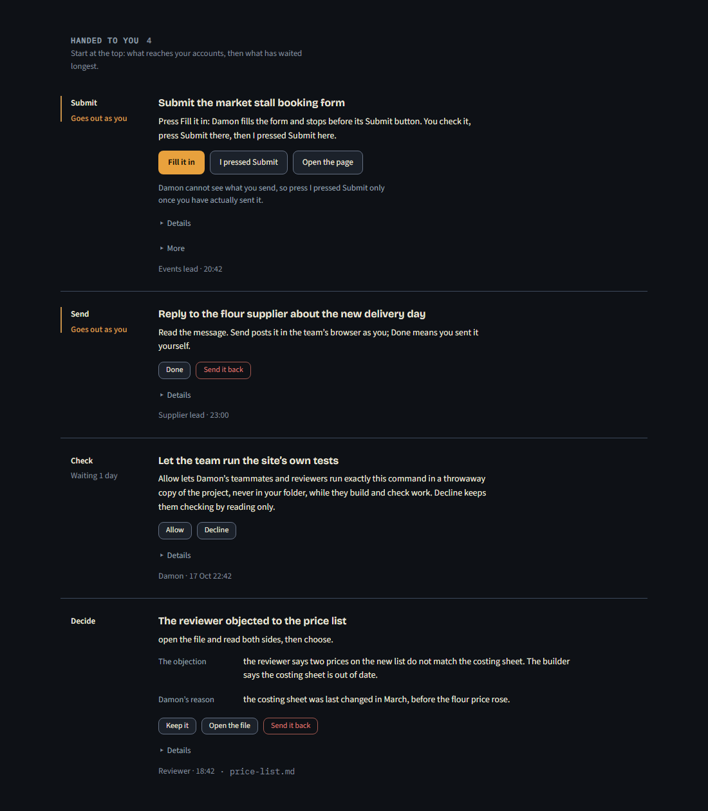
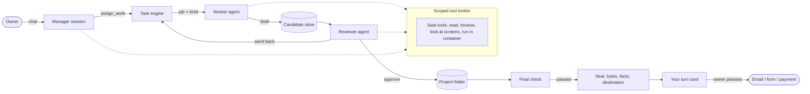

# Damon (core)

Damon is a Windows desktop app (Electron, React, TypeScript) where a manager model splits a piece of work into jobs, hands each job to an AI agent, and has a second agent review what comes back before anything lands in the owner's project folder. Anything that would leave the computer under the owner's name, such as an email, a form or a payment, stops on a list called **Your turn** and waits for the owner to press a button.

This repository is the core of that app: the orchestration, the review and seal logic, the scoped tool broker, the screen camera and the Your turn screen. The full app wires these together through an Electron main process and an IPC layer, which are not included here (see [What is not included](#what-is-not-included)).



*The Your turn screen, rendered from `src/renderer/preview/` with invented sample cards.*

## How it was built

I specified what Damon should do, directed the work and tested what was built, mostly by using the app every day on real projects and reporting what went wrong. AI coding agents (Claude Code and others) wrote the code. The tests in `tests/` were written the same way; many of them were added after a fault showed up in use.

## The parts worth reading

| Area | Files | What it does |
| --- | --- | --- |
| Task engine | `src/main/lib/task-engine.ts`, `task-admission.ts`, `task-operations.ts` | Queue of jobs per project: admission checks (scope, reads, acceptance criteria), dependencies (`waitsFor`), revision rounds with a cap, step-up to a stronger model, known-fault follow-ups, usage-limit pauses and resume. |
| Manager and agents | `manager-session.ts`, `manager-prompt.ts`, `agent-runner.ts`, `agent-prompt.ts`, `providers/` | Runs the manager and worker sessions through provider adapters (Claude, Codex, Gemini, and a native broker route). Builds each agent's brief from the job, its files and the owner's recorded decisions. |
| Review | `shared/review.ts`, `candidate-store.ts`, `candidate-review.ts`, `critique-store.ts`, `shared/product-critic.ts` | A worker's output is held as a *candidate* (a draft outside the project folder). A reviewer reads the draft and returns a verdict; only an approved draft is applied. A separate final check (the critique) judges what will leave the project. |
| Seal and outward actions | `outward-action.ts`, `ready-gate.ts`, `decision-hold.ts`, `shared/outgoing.ts`, `shared/your-turn.ts` | The seal records the exact bytes of every file that leaves, the facts it cites, and the destination. If any of these change after the check passed, the seal comes off and the card is not ready. |
| Scoped tools | `scoped-tool-broker.ts`, `broker-mcp.ts`, `protected-*.ts`, `shared/seat-tools.ts` | Each agent gets a tool list for its seat (worker, reviewer, manager). A call must belong to the active session and turn, and each tool checks the caller's project and capabilities before it runs. |
| Execution boundary | `execution-boundary.ts`, `execution-policy.ts`, `isolated-worker.ts` | On the protected route agents cannot run commands on the host. Commands run in a throwaway container, and only files inside the folder the owner approved can be read. |
| Screen camera | `lookers/screens.ts`, `lookers/camera-load.ts`, `shared/screen-job.ts`, `shared/visual-review.ts` | Serves a built screen, photographs each place at phone and desktop width (390 and 1280 px) in the chosen colour schemes, and hands the pictures to the reviewer, so a UI job is judged on what it looks like, not only on its code. The browser that takes the pictures is passed in as a dependency. |
| Your turn UI | `src/renderer/src/components/YourTurnView.tsx`, `src/main/lib/your-turn-store.ts` | The owner's list: send, submit, decide, check, pay, sign. Each card says what needs the owner, why, and what each button does. |

## Safety rules the code enforces

- **Nothing leaves without the owner's press.** Send, submit, sign and pay are cards on the Your turn list. A card becomes ready only when the seal holds (`outward-action.ts`, `sealGate`), and a press is kept for at most an hour while a check finishes (`pressStep`).
- **The form filler never presses the final submit.** *Fill it in* fills a form in the team's browser and stops before the site's own last button. The owner checks the form and presses Submit, then *I pressed Submit* in Damon (`shared/your-turn.ts`, `submitStage`, `submitActions`).
- **Reviewed work only.** A worker writes into a draft. The draft reaches the project folder only after a different agent has reviewed it, or after the owner explicitly chooses to keep it unreviewed (`candidate-store.ts`, `candidate-review.ts`, `task-engine.ts`).
- **Scoped tools.** A tool call from another session or turn, or outside the caller's project, is refused (`scoped-tool-broker.ts`, `BrokerRefusal`). Reviewers get read-only seats.
- **No host execution on the protected route.** `assertHostExecutionAllowed` refuses it; commands go to an isolated container instead.
- **Fetched content is data.** Agents are told never to follow instructions found in web pages or files, web tool results are labelled as data, and output from the isolated container is marked untrusted until it is reviewed (`agent-prompt.ts`, `protected-web-tools.ts`, `isolated-worker.ts`).

## Architecture



## Running it

```
npm ci
npm run typecheck      # tsc over src/
npx vitest run tests/<file>.test.ts --maxWorkers=2
npm run preview        # the Your turn screen with invented sample cards
```

Tested on Node 24. The preview page (`src/renderer/preview/`) renders the real `YourTurnView` component against an in-memory stand-in for the Electron bridge, with made-up cards.

## What is not included

- **The Electron shell and IPC layer** (`main/index.ts`, `ipc.ts`, the preload bridge and the rest of the renderer). They wire every feature of the full app together and are tied to features that are not part of this showcase.
- **Project-specific features.** The full app also runs my own projects. Those modules, their prompts, tests and fixtures were removed, and the places where core code referred to them were cut or replaced with neutral versions.
- **Marketing, sales and inbox modules**, vendored skill packs, the native Windows job helper, build scripts, design notes and working documents.
- **History.** This repository starts from a fresh commit. Code comments were removed in the copy, because they were a running log of the work; short headers describe the main modules instead.

So this repository typechecks and its tests run, but it does not start as an app on its own.
